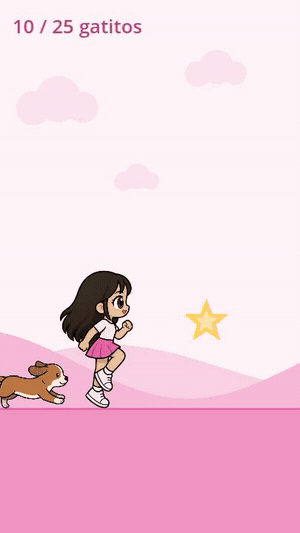

# ¡Corre, Sofía!

Un runner 2D en **Godot 4** que se personaliza entero desde un JSON. Cambias el
pedido y cambia el juego: el nombre, el género de todos los textos, el color de
piel, pelo y ropa del personaje, la mascota, y qué se recolecta.

Una sola base de código atiende a todos los clientes. Es el primer juego del
motor de [juegos-cumple](https://github.com/ivanriveraf/juegos-cumple), pensado
para regalos de cumpleaños de niños de 4 a 9 años.



> El pedido del GIF es un ejemplo (Sofía, 6 años, gatitos). Cambiando
> `config.json` el mismo ejecutable entrega el juego de otro niño.

## Lo interesante del proyecto

### Un JSON por pedido, cero código por cliente

```json
{
  "nombre": "Sofía",  "genero": "f",  "edad": 6,
  "mascota":  { "nombre": "Luna", "tipo": "perra", "genero": "f" },
  "coleccionable": { "singular": "gatito", "plural": "gatitos" },
  "personaje": { "piel": "#F0C29B", "pelo": "#2B2118", "ropaColor": "#E85DA1" }
}
```

El género gramatical se resuelve con *tokens*, porque en español cambia medio
texto: `¡Bienvenid[o|a|e], {nombre}!` → *¡Bienvenida, Sofía!*. Hay un token
aparte para el género de la mascota (`[m:o|a|e]`), y un *linter* que marca como
error cualquier token sin sus tres variantes.

El linter importa más de lo que parece: comprobar que un texto *resuelve* solo
prueba el género del pedido que tengas delante. Un texto escrito con dos
variantes pasa esa prueba con Sofía y con Pedro, y revienta el día que entre un
pedido neutro.

Los colores no son sprites distintos: un **shader de paleta** recolorea el
dibujo en la GPU conservando el sombreado, así que un solo juego de sprites
sirve para cualquier tono de piel, pelo y ropa.

### Todo número del arte está medido, no estimado

Esta es la parte que más trabajo costó. Las tiras de sprites se generan una por
una y **cada una sale distinta**, aunque sea el mismo personaje. Medir a ojo
produjo, en orden, estos fallos:

| Lo que se estimó | Lo que pasó en pantalla |
|---|---|
| La paleta | La falda a medio recolorear: azul y rosa mezclados, se veía violeta |
| Qué tono era el pelo | El recoloreo se comía la línea del dibujo — un tono afectaba al 47% del contorno |
| La escala del salto | La niña cambiaba de tamaño al aterrizar |
| El ritmo de la animación | Las piernas iban un 30% más rápido que el suelo: patinaban |
| La caja de colisión | Se perdía la partida por rozar el obstáculo con la punta del zapato |

Ahora cada número sale de medir el canal alfa de los PNG:

- **Ritmo**: la animación no avanza con el reloj sino con el **suelo recorrido**
  — 44 px por cuadro, medido siguiendo el pie apoyado. Así el pie no patina a
  ninguna velocidad, y subir la velocidad del juego no obliga a reajustar nada.
- **Colisión**: sale del **núcleo** del cuerpo (80 px) y no del dibujo (246 px);
  la diferencia es pelo al vuelo y miembros estirados, que no deberían matarte.
- **Anclaje**: por la cadera en el salto, porque los pies se recogen y la cabeza
  se hunde.

`herramientas/agregar_personaje.js` hace todas esas mediciones de una vez sobre
una tira nueva y escupe el bloque de código listo — y deja tres imágenes de
revisión, porque hubo decisiones que ningún número resolvió y hay que mirarlas.
Ver [herramientas/LEEME.md](herramientas/LEEME.md).

### Sonido sintetizado, no descargado

Los seis efectos los genera `herramientas/generar_sonidos.js` como WAV: ondas
triangulares, notas afinadas en do mayor y envolventes con ataque suave para que
no chasqueen. Son propios, así que se pueden publicar sin pedir permiso a nadie.

El tono de *recoger* sube con el avance: a los 25 gatitos suena medio tono más
alto que al primero, así el niño **oye** que se acerca a la meta sin mirar el
marcador.

### Se prueba solo

```bash
godot --headless --path . --script test.gd   # 91 comprobaciones
```

Incluyen que estén todos los cuadros de cada animación, que cada animación traiga
su propia paleta medida, que la caja de colisión salga del tronco y no del
lienzo, que corriendo por el suelo el obstáculo **sí** choque y que en lo alto
del salto **no**, y que el catálogo pueda cumplir el pedido que haya en
`config.json` — para que un pedido imposible salte en el taller y no en la
fiesta.

Y tres modos para depurar lo que no se ve:

| Bandera | Para qué |
|---|---|
| `--demo` | Piloto automático. Sirve para grabar el vídeo de cada pedido sin jugarlo a mano |
| `--cajas` | Dibuja las cajas de colisión encima del juego |
| `--torpe` | El piloto salta tarde a propósito, para que aparezcan los choques dudosos |

## Estructura

```
main.gd            juego: estados, física del salto, colisión, generación
src/
  arte.gd          catálogo de personajes y sus medidas
  paleta.gd        paletas por pack, puente con el shader
  sonido.gd        efectos, con varias voces
  genero.gd        motor de texto: género gramatical y variables
  textos.gd        textos del juego
  pedido.gd        carga el config del cliente
arte/              sprites propios + shader de recoloreo
audio/             efectos sintetizados
herramientas/      pipeline para añadir personajes al catálogo
test.gd            91 comprobaciones
config.json        el pedido (lo único que cambia entre clientes)
```

## Cómo probarlo

```bash
godot --path .                      # jugar
godot --path . -- --demo --cajas    # piloto automático, con cajas de colisión
node herramientas/generar_sonidos.js   # regenerar los efectos
```

Probado en escritorio, Android y iPhone (export HTML5, renderizador GL
Compatibility).

## Tecnologías

Godot 4.6 · GDScript · shaders GLSL · Node.js (herramientas de medición y
síntesis de audio) · ffmpeg

## Créditos

Desarrollo: **Iván Rivera**
([GitHub](https://github.com/ivanriveraf) ·
[LinkedIn](https://linkedin.com/in/ivan-patricio-rivera-fuentealba))

Los sprites y los efectos de sonido son propios. Los packs de terceros con
licencia sin confirmar no forman parte de este repositorio.

## Licencia

© 2026 Iván Rivera. Todos los derechos reservados.
